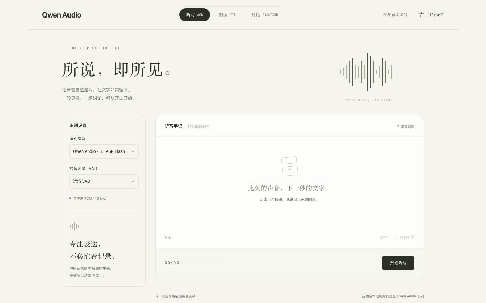
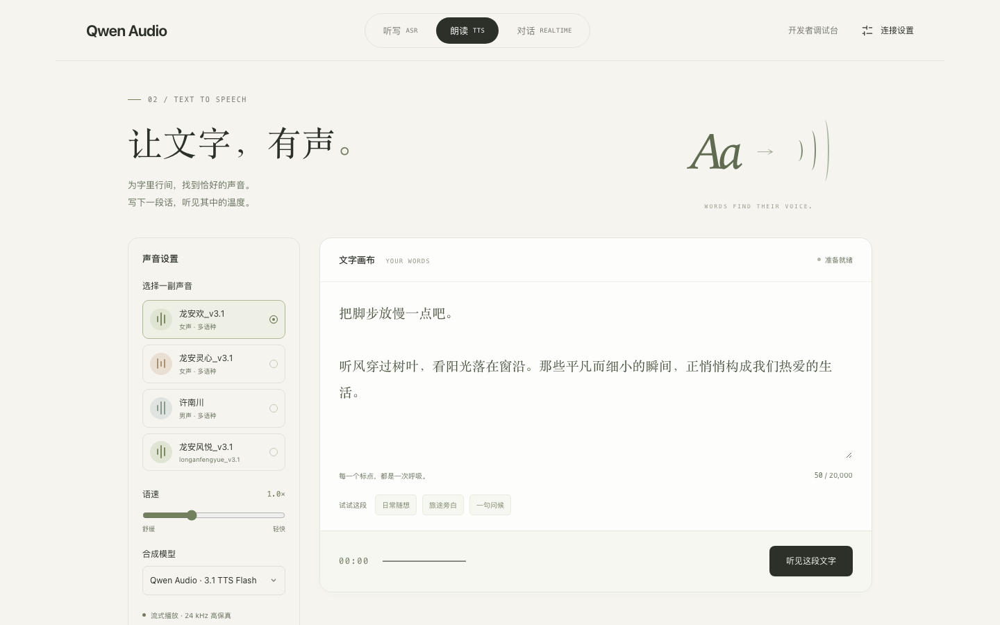
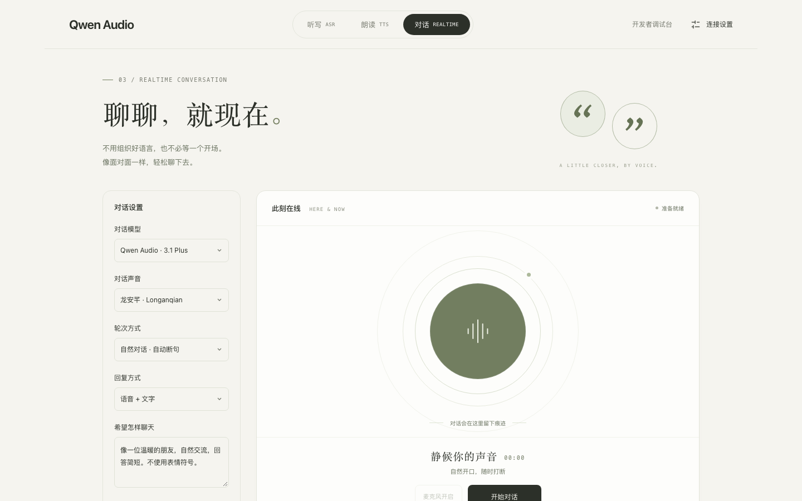

# Qwen Audio 体验平台（Node.js）

简体中文 | [English](./README_EN.md)

一个基于 Node.js SDK 的完整语音体验应用，在浏览器中体验 Qwen Audio 3.1 的实时听写、语音合成与实时对话，并附带可查看 SDK 协议帧的开发者调试台。

| 实时听写 | 语音合成 | 实时对话 |
| --- | --- | --- |
|  |  |  |

## 功能

| 页面 | 地址 | 默认模型 | 说明 |
| --- | --- | --- | --- |
| 实时听写 | `/` | `qwen-audio-3.1-asr-flash-streaming` | 麦克风 16 kHz PCM 实时识别，可切换 `fun-asr-realtime`，可选近场 / 远场 VAD |
| 语音合成 | `/tts.html` | `qwen-audio-3.1-tts-flash` | 流式播放 24 kHz 音频，可切换 `qwen-audio-3.1-tts-plus`，支持保存 WAV |
| 实时对话 | `/realtime.html` | `qwen-audio-3.1-realtime-plus` | 语音 / 文字双向对话，支持自然对话（自动断句）、语义判断（智能断句）与手动发送三种轮次方式 |
| 开发者调试台 | `/develop` | - | 集中调试 Realtime、TTS 与 ASR 参数，查看 SDK 上下行协议帧（凭据自动脱敏） |

调用链路为：浏览器页面 → `server.mjs` → Node.js SDK → 百炼服务。浏览器只与本地服务通信，服务端 `.env` 中的 API Key 不会下发到页面。

## 前提条件

- 已开通所用模型服务并获取百炼 API Key，详见 [PREREQUISITES.md](../../../PREREQUISITES.md)。
- 使用麦克风时需允许浏览器录音权限。
- Node.js 18 或以上版本；使用一键启动脚本时可不预先安装。

## 运行示例

### 一键启动（推荐）

在本目录执行：

```bash
# macOS / Linux
./start.sh
```

Windows 下双击或在命令行运行 `start.bat`。

启动脚本会依次完成：

1. 优先使用系统中 18 或以上版本的 Node.js；如果没有，则从 nodejs.org 下载官方 Node.js v24.22.2，经 SHA256 校验后安装到本目录的 `.runtime/`，不修改系统环境。
2. 检测依赖，缺失时按 `package-lock.json` 自动执行 `npm ci` 安装。
3. 启动服务并自动打开 `http://localhost:5173/`，按 `Ctrl+C` 停止。

再次运行会跳过已完成的步骤，直接启动服务。如提示没有执行权限，可改用 `bash start.sh`。

### 手动启动

已安装 Node.js 18+ 时，也可以在本目录执行：

```bash
npm ci
npm start
```

API Key 可以任选一种方式配置：

1. 在页面右上角“连接设置”中填写并保存，可选填业务空间 ID 和服务域名（默认 `dashscope.aliyuncs.com`）。配置只保存在当前浏览器的本地缓存（localStorage）中，每次请求随连接发给本地服务，服务端不保存，因此多人访问同一服务时各用各的配置。清除浏览器网站数据即可删除。
2. 在服务端配置文件中填写：复制 `.env.example` 为 `.env`，填写 `DASHSCOPE_API_KEY`（可选 `DASHSCOPE_WORKSPACE_ID`、`DASHSCOPE_BASE_URL`），也可以启动前直接设置这些环境变量。`.env` 已被忽略，不会提交到仓库。页面中 API Key 留空时使用这份配置。

可通过环境变量调整服务：

| 变量 | 默认值 | 说明 |
| --- | --- | --- |
| `PORT` | `5173` | 监听端口 |
| `HOST` | `0.0.0.0` | 监听地址，仅本机访问可设为 `127.0.0.1` |
| `NO_OPEN` | - | 设为 `1` 时不自动打开浏览器 |

例如：`HOST=127.0.0.1 PORT=8080 NO_OPEN=1 ./start.sh`。

## 目录结构

| 文件 | 说明 |
| --- | --- |
| `start.sh` / `start.bat` / `start.ps1` | 一键启动脚本，分别用于 macOS / Linux 与 Windows（`start.bat` 调用同目录的 `start.ps1`） |
| `bootstrap.mjs` | 检测并按锁文件补装依赖后启动 `server.mjs`，`npm start` 也通过它启动 |
| `server.mjs` | 本地服务：静态页面、HTTP 接口与 WebSocket 代理，调用 SDK 的 `RecognitionClient`、`SpeechSynthesizer`、`RealtimeClient` 和 `TranscriptionClient` |
| `public/` | 浏览器页面、麦克风采集与音频播放代码 |
| `sdk/dashscope-sdk-nodejs-0.1.0.tgz` | 百炼语音 Node.js SDK 安装包，`package.json` 通过 `file:` 引用 |
| `package-lock.json` | 固定依赖版本及 SDK 安装包校验值 |

> 注意：本示例使用的百炼语音 Node.js SDK 尚未发布到 npm，npm 上的同名包 `dashscope-sdk-nodejs` 是另一个项目，请勿直接 `npm install dashscope-sdk-nodejs` 替换。

## 安全提示

- 服务端 `.env` 中的 API Key 会供所有未在页面填写 API Key 的访问者使用。服务默认监听 `0.0.0.0`，在共享网络中请设置 `HOST=127.0.0.1`；公网部署需在反向代理层配置 HTTPS 和访问认证。
- 页面填写的 API Key 以明文保存在浏览器本地缓存中，请勿在公共电脑上保存；用完可清空 API Key 后保存，或清除浏览器网站数据。
- 远程使用麦克风需要浏览器信任的 HTTPS；反向代理需保留原始 `Host` 并转发 WebSocket。服务会校验 `Origin`，不接受跨域请求。
- 分享调试台日志前请确认已脱敏；实际服务调用可能产生费用。
