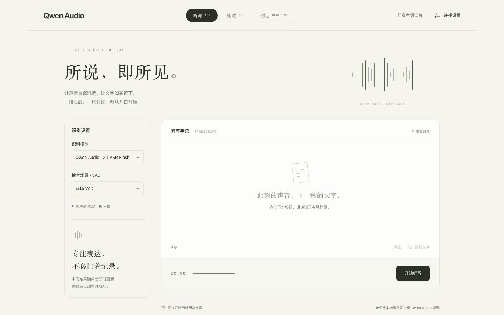
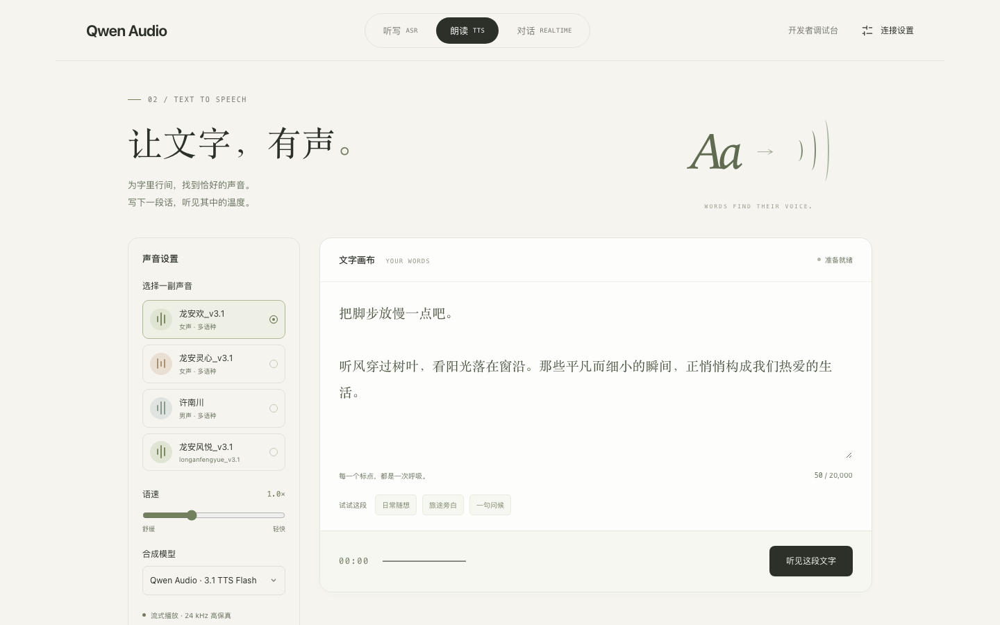
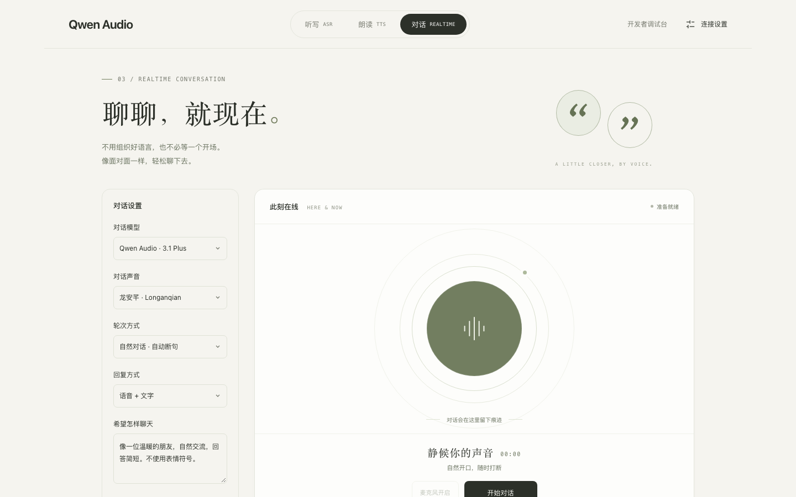

# Qwen Audio Experience (Node.js)

[简体中文](./README.md) | English

A complete voice web app built on the Node.js SDK. Try Qwen Audio 3.1 real-time dictation, speech synthesis and real-time conversation in the browser, plus a developer console that shows the SDK protocol frames.

| Real-time dictation | Speech synthesis | Real-time conversation |
| --- | --- | --- |
|  |  |  |

## Features

| Page | Path | Default model | Description |
| --- | --- | --- | --- |
| Real-time dictation | `/` | `qwen-audio-3.1-asr-flash-streaming` | Recognizes 16 kHz microphone PCM in real time; `fun-asr-realtime` and near/far-field VAD are selectable |
| Speech synthesis | `/tts.html` | `qwen-audio-3.1-tts-flash` | Streams 24 kHz audio; `qwen-audio-3.1-tts-plus` is selectable; the result can be saved as WAV |
| Real-time conversation | `/realtime.html` | `qwen-audio-3.1-realtime-plus` | Voice and text conversation with server VAD, semantic smart-turn and push-to-talk turn modes |
| Developer console | `/develop` | - | Tune Realtime, TTS and ASR parameters and inspect SDK upstream/downstream frames (credentials are redacted) |

Call chain: browser page → `server.mjs` → Node.js SDK → Model Studio. The browser only talks to the local server, so the API key in the server's `.env` is never sent to the page.

## Prerequisites

- The models you use are activated and you have a Model Studio API key. See [PREREQUISITES.md](../../../PREREQUISITES.md).
- Allow microphone access in the browser when using voice input.
- Node.js 18 or later. The one-click scripts can run without a preinstalled Node.js.

## Run the sample

### One-click start (recommended)

In this directory, run:

```bash
# macOS / Linux
./start.sh
```

On Windows, double-click `start.bat` or run it from a command prompt.

The script:

1. Uses the system Node.js if it is version 18 or later. Otherwise it downloads the official Node.js v24.22.2 from nodejs.org, verifies its SHA256 checksum and installs it into `.runtime/` in this directory, leaving the system untouched.
2. Checks the dependencies and runs `npm ci` from `package-lock.json` if any are missing.
3. Starts the server and opens `http://localhost:5173/`. Press `Ctrl+C` to stop it.

Later runs skip the completed steps and start the server directly. If the script is not executable, run `bash start.sh` instead.

### Manual start

With Node.js 18+ installed, you can also run in this directory:

```bash
npm ci
npm start
```

Configure the API key in either way:

1. Fill it in under "连接设置" (Connection settings) in the top-right corner of the page. The workspace ID and service domain (default `dashscope.aliyuncs.com`) are optional. The settings are kept only in this browser's local storage (localStorage) and are sent to the local server with each connection; the server never stores them, so several people can share one server with their own settings. Clear the site data in the browser to remove them.
2. Put them in the server's config file: copy `.env.example` to `.env` and fill in `DASHSCOPE_API_KEY` (optionally `DASHSCOPE_WORKSPACE_ID` and `DASHSCOPE_BASE_URL`), or set these environment variables before starting. `.env` is git-ignored. This config is used whenever the API key field on the page is left empty.

Environment variables for the server:

| Variable | Default | Description |
| --- | --- | --- |
| `PORT` | `5173` | Listening port |
| `HOST` | `0.0.0.0` | Listening address; use `127.0.0.1` for local-only access |
| `NO_OPEN` | - | Set to `1` to skip opening the browser |

For example: `HOST=127.0.0.1 PORT=8080 NO_OPEN=1 ./start.sh`.

## Layout

| File | Description |
| --- | --- |
| `start.sh` / `start.bat` / `start.ps1` | One-click launchers for macOS / Linux and Windows (`start.bat` runs the adjacent `start.ps1`) |
| `bootstrap.mjs` | Restores missing dependencies from the lock file and starts `server.mjs`; `npm start` also runs through it |
| `server.mjs` | Local server for static pages, HTTP APIs and the WebSocket proxy; uses the SDK's `RecognitionClient`, `SpeechSynthesizer`, `RealtimeClient` and `TranscriptionClient` |
| `public/` | Browser pages, microphone capture and audio playback |
| `sdk/dashscope-sdk-nodejs-0.1.0.tgz` | Model Studio speech Node.js SDK package, referenced from `package.json` via `file:` |
| `package-lock.json` | Pinned dependency versions and the SDK package checksum |

> Note: the Model Studio speech Node.js SDK used here is not yet published to npm. The npm package named `dashscope-sdk-nodejs` is a different project, so do not replace the bundled SDK with `npm install dashscope-sdk-nodejs`.

## Security

- The API key in the server's `.env` is used by every visitor who leaves the API key field empty. The server listens on `0.0.0.0` by default; set `HOST=127.0.0.1` on shared networks, and put HTTPS plus authentication in a reverse proxy for public deployments.
- An API key entered on the page is stored in plain text in the browser's local storage. Do not save it on a shared computer; when done, clear the API key and save, or clear the site data.
- Remote microphone access requires browser-trusted HTTPS. A reverse proxy must keep the original `Host` header and forward WebSocket traffic. The server validates `Origin` and rejects cross-origin requests.
- Check that developer console logs are redacted before sharing them. Real service calls may incur charges.
